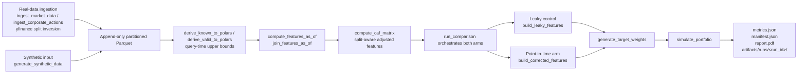

# Ledger

Ledger stores market and feature facts with valid time and knowledge time, then builds point-in-time features and compares a leaky control backtest with a corrected backtest.

## Contents

- [Key result](#key-result)
- [Lookahead classes](#lookahead-classes)
- [Architecture](#architecture)
- [Data model](#data-model)
- [Point-in-time semantics](#point-in-time-semantics)
- [Evidence](#evidence)
- [Quickstart](#quickstart)
- [Data quality and governance](#data-quality-and-governance)
- [Design decisions and trade-offs](#design-decisions-and-trade-offs)
- [Development](#development)
- [Limitations](#limitations)

## Key result

The controlled ablation is the first check: `test_removing_the_leak_makes_the_arms_identical` runs without the deliberately early EPS view and requires matching weights and key metrics. With the leak enabled, the leaky arm sees the amended EPS at calendar-day start; the corrected arm sees it only at its `known_from` time. The shared EPS screen then changes eligibility and holdings. The split-adjusted and as-traded price bases are not the cause of the measured gap in this experiment.

| Metric | Leaky arm | Corrected arm | Leaky - Corrected |
| --- | ---: | ---: | ---: |
| Cumulative return | +46.64% | +30.70% | +15.95 pp |
| Sharpe ratio | 0.558 | 0.423 | +0.136 |
| CAGR | 10.07% | 6.94% | +3.13 pp |
| Max drawdown | -28.29% | -28.29% | 0.00 pp |
| Annualized volatility | 20.25% | 20.09% | +0.17 pp |
| Calmar ratio | 0.356 | 0.245 | +0.111 |
| Win rate | 46.07% | 45.97% | +0.10 pp |
| Mean turnover | 0.264 | 0.270 | -0.006 |

Displayed deltas are computed from unrounded values, so subtracting the rounded values in a row may not reproduce its displayed delta. The demo uses one default synthetic seed (`PRNG_SEED = 20240106`); it is not a multi-seed result.

## Lookahead classes

| Class | What Ledger prevents | Canary |
| --- | --- | --- |
| Restatements | An amended filing is not available before its `known_from` time. | `canary_01_restatements` |
| Split treatment | Later splits do not alter raw historical prices or enter adjusted features before they are known. | `canary_02_retroactive_splits` |
| After-hours filings | A filing after market close is not used in that session's decision. | `canary_03_after_hours_session` |
| Survivorship | Historical universe queries can retain securities that were active at the historical date. | `canary_04_survivorship_universe` |
| Filing lag | A quarter-end value is not treated as available before its filing. | `canary_05_filing_lag_window` |
| Ticker relabeling | A time-varying ticker resolves to the stable `sec_id`. | `canary_06_ticker_relabeling` |

## Architecture



The bitemporal bounds are half-open:

```text
valid time:       valid_from ---------------------- valid_to
knowledge time:   known_from ---------------------- known_to
                  included                     excluded
```

### Repository map

- `ledger/ingestion/market_data.py`: yfinance OHLCV ingestion, split inversion, and ticker registration.
- `ledger/ingestion/corporate_actions.py`: split and cash-dividend ingestion.
- `ledger/storage/partitions.py`: append-only Parquet writers and `filter_already_persisted`.
- `ledger/core/bitemporal.py`: `derive_known_to_polars`, `derive_valid_to_polars`, and interval models.
- `ledger/core/entity.py`: permanent security identifiers and time-varying ticker resolution.
- `ledger/features/engine.py`: `join_features_as_of` and `compute_features_as_of`.
- `ledger/features/caf.py`: `compute_caf_scalar` and `compute_caf_matrix`.
- `ledger/backtest/runner.py`: `build_leaky_features`, `build_corrected_features`, and `run_comparison`.
- `ledger/backtest/strategy.py`: `generate_target_weights`.
- `ledger/backtest/simulation.py`: `simulate_portfolio`.
- `ledger/backtest/run_comparison.py`: CLI orchestration and run outputs.
- `ledger/lineage/manifest.py`: `build_manifest`, `write_manifest`, and `verify_manifest`.
- `docs/formal/Ledger.tla`: bounded TLA+ state-machine specification.

## Data model

The canonical real-data Parquet tables and the synthetic fundamentals fixture are summarized below. The upper bounds are derived; they are not persisted as immutable source columns.

| Table | Stored columns and dtypes | Key used by ingestion/query | Valid-time columns | Transaction-time columns | Partition layout and driver |
| --- | --- | --- | --- | --- | --- |
| `market_ohlcv` | `sec_id` String; `trade_date` Date; `open`, `high`, `low`, `close` Float64; `volume` Int64; `known_from` Datetime[us, UTC]; `ingestion_seq` Int64 | `(sec_id, trade_date, known_from)` | `trade_date` | `known_from`; derived `known_to` | `year=YYYY/month=MM`, derived from `trade_date` |
| `corporate_actions` | `sec_id` String; `action_type` String; `ex_date` Date; `split_ratio` Float64 (nullable); `cash_amount` Float64 (nullable); `announcement_date` Date; `known_from` Datetime[us, UTC]; `ingestion_seq` Int64 | `(sec_id, action_type, ex_date, known_from)` | `ex_date` | `known_from`; derived `known_to` | `year=YYYY`, derived from `ex_date` |
| `entity_map` | `sec_id` String; `ticker` String; `valid_from` Datetime[us, UTC]; `ingestion_seq` Int64 | `(sec_id, ticker, valid_from)` | `valid_from`; derived `valid_to` | No transaction-time column in the mapping record | Flat `entity_map` directory |
| Synthetic fundamentals fixture | `sec_id` String; `filing_type` String; `fiscal_period_end` Date; `metric_name` String; `metric_value` Float64; `known_from` Datetime[us, UTC]; `is_restatement` Boolean; `ingestion_seq` Int64 | `(sec_id, metric_name, fiscal_period_end)` for the version stream | `fiscal_period_end` | `known_from`; derived `known_to` | In-memory synthetic frame; no persistent fundamentals partition writer |

`market_ohlcv` and `corporate_actions` use their event dates, not `known_from`, to choose partition directories. `entity_map` is not date-partitioned. The fundamentals schema above describes the synthetic fixture; real-data `run-comparison` sets fundamentals to `None` and does not ingest a fundamentals source.

Worked restatement example (illustrative): suppose one quarter has an original value of 5.0 with `known_from = T1`, followed by an amended value of 3.5 with `known_from = T2`, where `T1 < T2`. The derived `known_to` for the original row is `T2`. At `as_of < T1`, neither version is available; at `T1 <= as_of < T2`, the original is available; at `as_of >= T2`, the amended row is available. This follows the `known_from <= as_of` and exclusive derived-upper-bound semantics; the example dates and values are illustrative, not a run output.

## Point-in-time semantics

`join_features_as_of` performs a backward ASOF join on the selected temporal key. A caller with both `known_from` and `valid_from` must choose `right_on`; otherwise the feature engine rejects the ambiguous input. If an upper-bound column is provided/detected, rows at or past it are masked. Thus the engine applies `known_from <= observation_timestamp` for a knowledge-time join and, when the selected bound is `known_to`, also requires `observation_timestamp < known_to`. A `valid_to` bound is checked when that is the selected bound; the join does not unconditionally apply both upper bounds.

`known_to` is derived by ordering each configured partition by `(known_from, ingestion_seq)` and taking the next `known_from`. `valid_to` is similarly derived by `(valid_from, ingestion_seq)`. The ASOF candidate is the backward match on the chosen join key. Bound derivation uses `ingestion_seq` to order tied starts, but `join_features_as_of` sorts the right side by the temporal key alone, so it does not define a separate `ingestion_seq` tie-break for equally timed ASOF candidates. Valid-time columns are not independently applied to a knowledge-time ASOF join unless the caller selects them as the temporal key or bound.

For quarterly fundamentals, the previous known quarter remains the last ASOF candidate until the next filing becomes known. The filing-lag canary checks that Q1 stays hidden until SEC acceptance; the synthetic fixture also includes a carry-in filing to avoid a null-only start window.

### Split adjustment

For a stored price, Ledger multiplies the price by:

`CAF = PRODUCT(1 / split_ratio)` over splits satisfying `trade_date < ex_date <= observation_date` and `known_from <= observation_timestamp`.

The CAF uses splits only. The corporate-actions ingestion stores cash dividends as `CASH_DIVIDEND` records, but `compute_caf_matrix` does not apply them. The backtest does not calculate dividend-adjusted total returns.

## Evidence

### Synthetic experiment

The synthetic input has one 4:1 forward split for the first security and one EPS restatement for a selected security. The injected leak is in `leaky_fundamentals_view`: it changes the amended EPS view's availability to calendar-day start. Canary 07 supplies the same underlying fundamentals to both arms, with the leaky view for the control and the original bitemporal view for the corrected arm; both use `require_eps_above=EPS_SCREEN_THRESHOLD`. The screen falls between original and amended EPS, so premature visibility can alter eligibility and portfolio weights.

The two arms share the observation matrix, strategy/simulation configuration, and—when supplied—the same fundamental facts. The control consumes pre-adjusted prices, treats them as available at day start, and passes no splits to its feature calculation. The corrected path consumes as-traded prices and split data, applies point-in-time feature construction, and makes the split adjustment for simulation. In Canary 07's no-leak fixture, the strategy omits the EPS screen and the early-availability view; the test requires weights and cumulative return, Sharpe, and drawdown to match. Therefore the enabled experiment's observed performance gap is isolated to the early EPS availability screen, not a return difference caused by comparing split-adjusted and as-traded price series.

The demo strategy is long-only cross-sectional momentum. Its feature inputs are `momentum_20d`, `volatility_20d`, and `sma_50d`; it ranks by momentum, applies the `price > sma_50d` trend check, then weights the selected names by inverse volatility. The Canary 07 setup uses `top_n=3`, daily observations/rebalancing, the EPS-above threshold, five synthetic securities, and 5 bps transaction costs. No buy-and-hold comparison is included. The unchanged displayed maximum drawdown does not establish a general reason why drawdown must be unaffected.

### Real-data split handling

Market ingestion calls yfinance, then reverses the provider's full-history split adjustment for OHLC prices using split ratios whose ex-date is after each `trade_date`. Volume is left as reported. The tests include the AAPL price-basis example and TSLA's 5:1 and 3:1 split inversion case.

### Formal model and runtime evidence

| TLA+ invariant | Runtime counterpart | Test evidence |
| --- | --- | --- |
| `NoOverlap` | `derive_known_to_polars` derives upper bounds from the next `known_from`. | `tests/property/test_bitemporal_invariants.py` covers derived-interval properties; the invariant is not enforced by TLA+ at runtime. |
| `Monotonic` | `TransactionInterval` validates transaction interval bounds. | `tests/property/test_bitemporal_invariants.py` covers the derived-bound property. |
| `NoGaps` | Adjacent derived knowledge bounds are computed from the next `known_from`. | `tests/property/test_bitemporal_invariants.py` covers derived-bound properties. |
| `ValidBeforeKnown` | No general runtime check enforces `known_from >= valid_from`. | No direct runtime-test counterpart identified. |
| `IdempotentReplay` | `filter_already_persisted` removes identical persisted payloads and keeps changed payloads. | `tests/unit/test_raw_price_basis.py` exercises replay filtering. |

The checked-in TLC log records TLC 2.18 checking the five invariants above across 22,158 distinct reachable states with no invariant violation. The current `Ledger.cfg` bounds the model to `SecIDs = {"SEC_AAPL", "SEC_TSLA"}`, `MaxTime = 4`, and `MaxEvents = 4`; the committed log does not print those constants, so the state count should be read as the logged run, not as a fresh verification of the current configuration. TLC checks the abstract bounded model; it does not enforce runtime behavior. The `tla2tools.jar` dependency must be supplied separately for a headless TLC run; the formal documentation points to the TLA+ releases and gives the invocation below.

## Quickstart

### Requirements and installation

The package declares Python `>=3.10`; CI currently runs Python 3.11. Install the editable package and development dependencies:

```bash
git clone https://github.com/laila-kz/Ledger.git
cd Ledger
python -m pip install -e ".[dev]"
```

### Synthetic comparison

```bash
ledger run-comparison --synthetic --start-date 2020-01-01 --end-date 2023-12-31
```

The command writes `metrics.json`, `manifest.json`, and `report.pdf` under `artifacts/runs/<run_id>/`. The tear sheet is a PDF comparison report containing metrics, curves, and manifest-related details.

### Real-data comparison

```bash
ledger run-comparison --start-date 2018-01-01 --end-date 2023-12-31 --tickers AAPL MSFT NVDA META GOOGL
```

The raw OHLCV and corporate-action Parquet inputs must already exist under the selected data root or be specified with the supported path options. Unless `--preadjusted-prices-path` is given, the control series is downloaded from yfinance. The CLI does not ingest fundamentals for this real-data comparison.

### Other commands

```bash
ledger canaries
ledger lint examples/sample_strategy.py
ledger verify-manifest artifacts/runs/<run_id>/manifest.json
pytest
pytest -m integration tests/integration
```

`ledger lint` runs the static AST leakage checks against the named Python file. The default pytest configuration excludes tests marked `integration`; run the integration selector separately when network/live-feed access is available.

To rerun TLC from the repository root after supplying `tla2tools.jar`:

```bash
java -cp tla2tools.jar tlc2.TLC -config docs/formal/Ledger.cfg docs/formal/Ledger.tla
```

### Run identifiers and manifest

`run_id` is the first 16 hexadecimal characters of SHA-256 over canonical JSON for the `reproducible` manifest section. That section includes Ledger and Python versions, platform, Git commit SHA, lockfile metadata, input snapshots, feature metadata, parameters, and results. The audit timestamp and dirty-tree information are outside that hash input. The manifest records SHA-256 digests for input files, feature definitions/source, and a discovered lockfile when present. Digests are unsigned: they support integrity/reproducibility checks, not authorship authentication.

### Docker Compose

The Docker image uses `python:3.11-slim`. Compose defines `canaries`, `comparison`, `lint`, and `test` services. Only `comparison` bind-mounts `./artifacts/runs` to `/workspace/artifacts/runs`; the other services have no declared volume mount. The `test` service runs Ruff lint/format checks, `mypy ledger`, and pytest with coverage.

```bash
docker compose run --rm canaries
docker compose run --rm comparison
docker compose run --rm lint
docker compose run --rm test
```

## Data quality and governance

- `validate_observation_matrix` requires `sec_id` and `observation_timestamp`, rejects nulls in those coordinates, and normalizes timestamps to UTC.
- `ValidInterval` and `TransactionInterval` validate their own interval bounds. The feature engine rejects ambiguous temporal join keys and masks rows that exceed the selected derived upper bound.
- `filter_already_persisted` treats a row as a replay only when its persisted payload matches; identical rows are skipped and changed payloads are retained as corrections. Append-only behavior is a storage convention plus `filter_already_persisted`, not an immutable database guarantee.
- OHLCV and corporate actions are sourced from yfinance in the ingestion modules. The synthetic EPS/fundamentals stream is generated in `ledger/backtest/synthetic.py`; real-data `run-comparison` has no fundamentals input. The real-data backtest uses the supplied raw universe, not a source of delisted securities.
- Market ingestion timestamps use the exchange session close plus a 15-minute buffer. Observation timestamps are normalized to UTC. The project does not define a general vendor-independent calendar policy for all upstream data.
- The manifest supports lineage checks for input files, feature definitions, lockfile metadata, and Git commit. The digest is not signed.
- yfinance data is subject to the provider's applicable terms.

## Design decisions and trade-offs

- **Polars and DuckDB:** feature construction, CAF calculation, and ASOF joins are implemented in Polars. DuckDB supplies Parquet-backed catalog views and SQL `LEAD` derivation. No test asserting cross-engine equivalence was identified.
- **Append-only with derived bounds:** raw records retain start times and sequence values; `known_to` and `valid_to` are derived from later rows. Ingestion skips unchanged payloads but preserves differing payloads.
- **Partitioning:** market data is grouped by `trade_date` year/month; corporate actions by `ex_date` year. Entity mappings use a flat directory.
- **yfinance split inversion:** OHLC are restored to as-traded levels using later split ratios before raw persistence; volume is not rescaled.
- **Typing:** mypy is configured in strict mode, with `ignore_missing_imports` overrides for third-party modules including yfinance, exchange_calendars, vectorbt, scipy, reportlab, matplotlib, and hypothesis.

## Development

CI runs on pushes to `main` and `Work-in-progress` and on pull requests, using Python 3.11. It runs:

- `ruff check .`
- `ruff format --check .`
- `mypy .`
- `pytest -v --cov=ledger --cov-report=term-missing`
- `pytest tests/property/ -v --hypothesis-seed=42`

`requirements.txt` pins package versions with `==`; it is not a hash-pinned requirements file. `pyproject.toml` sets the package floor to Python `>=3.10`; the CI matrix contains Python 3.11 only. The package metadata declares MIT, and a `LICENSE` file is present. Coverage is invoked by CI through `pytest-cov`; no coverage threshold is configured in `pyproject.toml`.

## Limitations

- The synthetic comparison uses one default seed. No buy-and-hold baseline is included.
- The displayed comparison is an experiment, not a benchmark of production-scale performance; no performance figures are presented here.
- Fundamentals in the demo are synthetic; the real-data comparison path does not load a fundamentals feed.
- The feature engine performs targeted validation; there is no general schema-validation layer covering every stored business table.
- Storage is local partitioned Parquet with Polars and DuckDB. The project does not implement streaming, distributed execution, cloud deployment, a web UI, intraday backtesting, or automatic corporate-action discovery.
- The current ingestion path stores and recognizes split and dividend records, but CAF and backtest returns are split-based and do not include dividend reinvestment or dividend-adjusted total returns.

## Links

- [Claims ledger](docs/CLAIMS.md)
- [Changelog](CHANGELOG.md)
- [Demo runbook](DEMO_RUNBOOK.md)

The runbook describes a recorded demo video; the video is not hosted in the repository.
